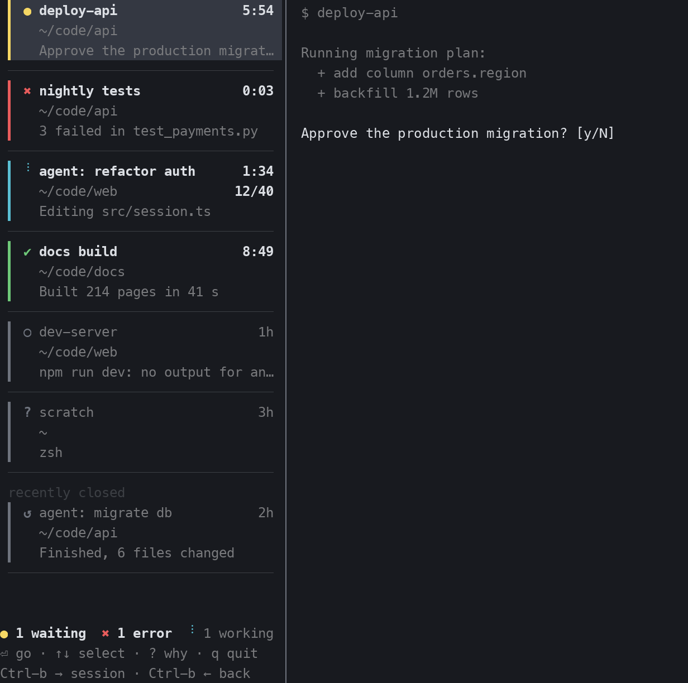

# sebside-tmux

A tmux sidebar that shows every session as a card, so you can see at a glance who is working, who is waiting for
you, and what just finished.



## Why

When you run many long jobs in tmux (AI agents, builds, test runs, dev servers), the hard part is not starting them.
It is noticing which one needs you *right now*. tmux's own session list shows names, not state.

sebside keeps a narrow pane on the left with one card per session or task:

- **waiting** (yellow ●) and **error** (red ✖) cards float to the top: they need you.
- **working** (cyan spinner) means busy, nothing to do.
- **done** (green ✔) means finished; it turns quiet once you have looked at it.
- **quiet** (grey ○) and **unknown** (grey ?) show their state in the bar and icon only; the text of a live card is
  never dimmed.
- Recently closed cards stay at the bottom, dimmed and greyed, and can be resumed with Enter. The `✕` at the right
  end of their first line (or `x` / Delete) forgets one.

It works with plain tmux out of the box (session name, directory, current command, last activity). Any program can
make its card richer with one command: `sebside card set --id build --state working --desc "compiling"`.
It knows nothing about any particular tool. Colors come from your terminal theme: only the 16 ANSI colors, bold and
dim are used.

## Install

You need tmux 3.0 or newer and Python 3.12 or newer.

```sh
uv tool install sebside-tmux             # or: pipx install sebside-tmux
uvx --from sebside-tmux sebside --help   # try it without installing
```

Then add the tmux plugin with [TPM](https://github.com/tmux-plugins/tpm) in `~/.tmux.conf`:

```tmux
set -g @plugin 'swojtyna/sebside-tmux'
```

and press `prefix + I` to install it. Without TPM, clone the repo
(`git clone https://github.com/swojtyna/sebside-tmux ~/.tmux/sebside-tmux`) and add
`run-shell ~/.tmux/sebside-tmux/sebside.tmux` to your `tmux.conf`. The `sebside` command must be on tmux's `PATH`;
if `uv` says its tool directory is not on your `PATH`, run `uv tool update-shell` and restart tmux. If `sebside` is
missing, the plugin shows a message with the install command.

## Quick start

1. Press `prefix + S` (by default `Ctrl-b S`). The sidebar opens on the left of the current window.
2. `↑`/`↓` (or `j`/`k`, or the mouse wheel) select a card, `Enter` (or a left click on the card) switches to that session.
3. `Ctrl-b →` moves to your session, `Ctrl-b ←` back to the sidebar. `q` closes it, so does `prefix + S` again.
4. `?` explains where the selected card's state came from (tmux basics or a card file, and how old it is).

In any pane, give it a real card:

```sh
sebside card set --id build --state working --title "build" --desc "compiling 120 files"
make && sebside card set --id build --state done --desc "build ok" \
     || sebside card set --id build --state error --desc "build failed"
```

## Cards: the contract

A card is one JSON file in `$XDG_STATE_HOME/sebside/cards/<id>.json` (default `~/.local/state/sebside/cards/`).
The file is the single source of truth. `sebside card set` writes it atomically (temporary file and rename, mode
0600, directory 0700). Inside tmux it also sets two pane options, `@sebside_id` and `@sebside_state`, so the
sidebar knows which pane the card belongs to and your status line can show the state.

| `card set` flag | File field | Shown as | Default when empty |
|---|---|---|---|
| `--id` (required) | `id` | (identity) | none |
| `--state` (required) | `state` | icon, color, order | none |
| `--title` | `title` | line 1, bold | session name |
| `--subtitle` | `subtitle` | line 2, dimmed | pane directory |
| `--desc` | `desc` | line 3, dimmed, cut with … (max 300 characters) | current command |
| `--extra` | `extra` | right side of line 2 (line 1 when `show_age = false`) | nothing |
| `--resume` | `resume` (argv list) | Enter on a closed card | not resumable |
| `--cwd` | `cwd` | directory for resume | current directory |
| (automatic) | `tmux`: socket, server pid, pane | which pane is live | `null` outside tmux |
| (automatic) | `schema`, `rev`, `created_at`, `updated_at`, `closed_at` | age on the right | |

States: `waiting`, `error`, `working`, `done`, `quiet`, `unknown`. Text is cleaned of control characters.

**Live or closed.** A card is live when its tmux server (socket and server pid) is running and its pane still
exists. On every refresh the sidebar closes cards whose pane is gone ("reconciliation"); the plugin's
`session-closed` hook only nudges that. Pane ids reused after a tmux restart cannot claim an old card, because the
server pid differs. A card set outside tmux has no pane, is shown without one, and stays open until you clear it.

**Stale.** A card whose last update and last pane output are both older than `stale_hours` is shown as unknown.

**Resume.** `--resume "agent --resume 1234"` is split into words and stored as a list. Enter on a closed card shows
the exact command first and runs it after a second Enter, in a new detached tmux session, without a shell. Only
programs listed in `resume_programs` in the config can be resumed, and only from card files owned by you with no
group or other permissions. If a live card with the same id exists, Enter switches to it instead.
The allowlist covers the program, not its arguments: anything that can write a card file decides the arguments, so
never list a shell or interpreter (`bash`, `sh`, `python`, `ssh`, `npx`, `env`) in `resume_programs`.

Other commands:

```sh
sebside card clear [--id ID] [--forget]   # close the card (keep it in history unless --forget)
sebside card list                         # live and recently closed cards as JSON
sebside reconcile                         # close cards whose pane is gone (the hook runs this)
sebside config path | show | get KEY
sebside uninstall                         # remove hook, key binding, sidebar panes and @sebside_* pane options
```

Exit codes: 0 ok, 1 runtime error, 2 usage error, 3 tmux missing or not running, 4 state not readable or writable.

## Configuration

Everything is optional. `~/.config/sebside/config.toml` (or `$XDG_CONFIG_HOME/sebside/config.toml`, or the path in
`$SEBSIDE_CONFIG`):

```toml
width = 36             # sidebar width used by the plugin (columns)
history = 5            # closed cards shown at the bottom
stale_hours = 12       # no update and no output this long -> unknown
quiet_minutes = 10     # a session without a card is quiet after this long without output
refresh_seconds = 1.5  # tmux poll interval; card file changes show up at once
show_age = true        # false hides the time on the right of line 1; the card's extra text takes its place
sort = "attention"     # attention | recent | name
resume_programs = []   # programs a closed card may be resumed with, e.g. ["vim", "my-agent"]

[icons]                # several characters = animation frames
waiting = "●"
working = "⠋⠙⠹⠸⠼⠴⠦⠧⠇⠏"
done = "✔"

[colors]               # ANSI names (red, bright-cyan, grey, default) or #rrggbb
waiting = "bright-yellow"
selected-bg = "grey"

[filter]               # glob patterns on session names
include = ["*"]
exclude = ["scratch-*"]
```

Environment variables beat the file; the `sebside sidebar` flags `--sort` and `--history` beat both: `SEBSIDE_WIDTH`, `SEBSIDE_HISTORY`, `SEBSIDE_STALE_HOURS`,
`SEBSIDE_QUIET_MINUTES`, `SEBSIDE_REFRESH_SECONDS`, `SEBSIDE_SORT`; also `SEBSIDE_STATE_DIR`,
`SEBSIDE_TMUX_SOCKET` and `SEBSIDE_DEBUG=1` (debug log in the state directory).

tmux options, set them **before** the plugin line in `tmux.conf`:

| Option | Default | Meaning |
|---|---|---|
| `@sebside-key` | `S` | key after the prefix that toggles the sidebar (`S` is bound only if it is free) |
| `@sebside-width` | config `width` | sidebar width in columns or percent (`25%`, tmux 3.1+), always under half the window |
| `@sebside-hook` | `on` | `off` skips the `session-closed[97]` hook |
| `@sebside-auto` | `off` | `on` opens the sidebar in every new session and window (see below) |
| `@sebside-close-alone` | `on` | `off` keeps a sidebar open when it is the last pane in its window (see below) |
| `@sebside-focus` | (unset) | `main`: after Enter switches session, the cursor lands in the main pane, not the sidebar |

### Opening the sidebar automatically

Enter on a card switches your client to another session. If each tool or agent runs in its own session, that
session needs a sidebar too, or it disappears after the switch. Two ways to get one:

```tmux
set -g @sebside-auto on     # before the plugin line
```

installs two hooks at fixed array indexes, so they never replace your own hooks and reloading `tmux.conf` is safe:

```tmux
set-hook -g session-created[96] 'run-shell -b "sebside --socket <socket> open --if-missing --target #{window_id}"'
set-hook -g after-new-window[98] 'run-shell -b "sebside --socket <socket> open --if-missing --target #{window_id}"'
```

(the plugin writes the real, quoted command). Only new sessions and windows get a sidebar; existing ones keep
what they have (press `prefix + S` there). Set the option back to `off` and reload to remove both hooks.

### Closing when the main program ends

When the program in the main pane exits (or you close that pane), the sidebar would keep the window and session
alive. So a sidebar that finds itself alone in its window, after a main pane was there once, ends its own process
within one refresh; tmux then closes the window and session as usual, and its `detach-on-destroy` option decides what
your client does. It never closes while any main pane remains in the window, and it never kills a pane (it only
exits). A sidebar started by itself in an otherwise empty window stays. `set -g @sebside-close-alone off` turns this
off; the option is read when the sidebar is about to close, so it takes effect without a reload.

You can also run it yourself: `sebside open --if-missing` adds the sidebar on the left of the current window (or of
`--target @3`) only if that window has none. It is quiet, safe to repeat, and exits 0 when the sidebar is already
there. The new pane does not take focus.

```tmux
set -g @sebside-focus main  # before the plugin line
```

keeps the cursor out of the sidebar: after Enter switches session, sebside selects the card's pane, or the first
pane that is not a sidebar if the card's pane is one. Without the option the focus stays as tmux leaves it.

## Integrations

Anything that can run a command can drive a card. A few examples:

**A shell script**

```sh
#!/bin/sh
sebside card set --id backup --state working --title "backup" --desc "rsync to nas"
if rsync -a ~/photos nas:/backup/; then
  sebside card set --id backup --state done --desc "backup finished"
else
  sebside card set --id backup --state error --desc "rsync failed"
fi
```

**A long-running test watcher**

```sh
while inotifywait -qq -r -e modify src; do
  sebside card set --id tests --state working --desc "running tests"
  if out=$(pytest -q 2>&1 | tail -1); then state=done; else state=error; fi
  sebside card set --id tests --state "$state" --desc "$out"
done
```

**An AI coding agent (example: a Claude Code hook)**

Agents that support hooks can report "waiting for you" and "done" directly. A Claude Code hook script receives JSON
on stdin with a `session_id` and the event name:

```sh
#!/bin/sh
# registered for the Notification, Stop and UserPromptSubmit hook events
input=$(cat)
id=$(printf '%s' "$input" | jq -r .session_id)
case $(printf '%s' "$input" | jq -r .hook_event_name) in
  Notification)     state=waiting ;;
  Stop)             state=done ;;
  UserPromptSubmit) state=working ;;
  *)                exit 0 ;;
esac
sebside card set --id "$id" --state "$state" --resume "claude --resume $id" >/dev/null
```

Add `claude` to `resume_programs` to resume closed agent sessions from the sidebar. Other agents and tools work
the same way: pick a stable id and map your events to states.

## FAQ

**Does it work without any integration?** Yes. Every session gets a card from tmux basics. Cards just get better
when something calls `sebside card set`.

**Can it type into my sessions or kill them?** No. The sidebar only reads tmux and switches your client to the card
you pick, through an explicit, tested allowlist of tmux commands. It never sends keys, never runs a shell through
tmux and never kills anything. (A sidebar left alone in its window exits by itself; that ends only its own process.) The explicit exceptions: Enter on a closed card starts a new session for its resume
command (after you confirm), the plugin's toggle key closes the sidebar pane, `sebside open` (and the optional auto-open hooks) adds a sidebar
pane, and `sebside uninstall` removes sebside's own hooks, key and sidebar panes.

**The colors look wrong.** sebside uses your terminal's 16 ANSI colors. Change them in your terminal theme, or
override them per state in `[colors]`.

**Does it support the mouse?** Yes. Click a card to select it and jump to it (same as Enter), and use the wheel to
move the selection. Clicks on empty rows, the footer or the "recently closed" header do nothing, and while the explain view is open clicks are ignored, so a click never starts a resume (in the confirmation a click cancels it). It needs tmux
`set -g mouse on`. Sidebars that were already running pick it up after a restart.

**Which card is my session?** The card of the session this sidebar sits in has a bold `●` at the right end of its
second line, in the card's state colour. It is separate from the selection, which only moves with keys or the mouse.

**Where is my data?** Only in `~/.local/state/sebside/cards/` and in your tmux pane options. Nothing leaves your
machine.

**How do I remove it?** Run `sebside uninstall`, remove the plugin line from `tmux.conf`, then
`uv tool uninstall sebside-tmux`. Card files stay in the state directory until you delete them.

## Development

```sh
uv sync
uv run pytest                 # integration tests need tmux and run on a private tmux server
uv run pytest -m "not tmux"   # unit tests only
uv run ruff check && uv run ruff format --check
uv run mypy
scripts/demo.sh               # try the sidebar on a private tmux server with demo cards
uv run --with pillow python scripts/screenshot.py docs/screenshot.png
```

The integration tests start their own tmux server on a temporary socket and never touch your default server.
See [docs/ARCHITECTURE.md](docs/ARCHITECTURE.md) for the design rules and [CONTRIBUTING.md](CONTRIBUTING.md).

## License

MIT, see [LICENSE](LICENSE).
